# Playbook ICPC de Hardware, Pinout y Resolución de Fallas (ESP32)

Esta guía está diseñada para **no perder ni un minuto en el laboratorio**. Todo el cableado está calculado para que puedas conectar **LM35 + Infrarrojo + Servomotor + RFID MFRC522 (+ OLED opcional) al mismo tiempo** en un **ESP32 DevKit**, con **WiFi encendido**, sin quemar módulos y sin conflictos de pines.

---

## 1. Mapa Maestro de Pines Seguros (Todos los Componentes Juntos)

| Componente | Pin del Módulo | Pin ESP32 | Voltaje VCC | Notas Críticas de Ingeniería |
| :--- | :--- | :--- | :--- | :--- |
| **LM35** (Temperatura) | `VCC` / `OUT` / `GND` | **GPIO 34** (ADC1_CH6) | **VIN (5V)** *(o 4V-5V)* | **¡NUNCA usar ADC2 con WiFi!** `GPIO 34` es solo entrada ADC1. El LM35 da `10 mV/°C` (a 100°C entrega `1.0 V`), totalmente seguro para el pin de 3.3V del ESP32. Alimentarlo a `VIN (5V)` cumple su mínimo de datasheet (`4V`). |
| **IR Obstáculo / Línea** (FC-51 / TCRT5000) | `DO` (Digital) | **GPIO 32** (ADC1_CH4) | **`3.3V` (estricto)** | Alimentarlo a `3.3V` hace que su salida `DO` sea 3.3V directa y segura (los pines del ESP32 **no toleran 5V**). Lógica típica: `LOW` cuando detecta obstáculo. |
| **IR Analógico** *(opcional)* | `AO` (Analógico) | **GPIO 35** (ADC1_CH7) | `3.3V` | `GPIO 35` es ADC1 puro (solo entrada). Ideal para calibrar umbral dinámico. |
| **IR Control Remoto** *(si usan VS1838B/KY-022)* | `OUT` / `S` | **GPIO 27** | `3.3V` | Pin digital limpio, sin conflictos con SPI ni I2C ni arranque. |
| **Servomotor** (SG90 / MG90S / MG995) | Señal (`Naranja/Amarillo`) | **GPIO 25** *(o `GPIO 13`)* | **5V EXTERNOS / VIN** | **NUNCA conectar el rojo (`VCC`) al pin `3V3` del ESP32** (reinicia el ESP32 por caída de tensión / *brownout*). Unir **GND de la fuente 5V con GND del ESP32**. |
| **RFID MFRC522** (SPI) | `SDA (SS / CS)` | **GPIO 5** | **3.3V ESTRICTO** | **¡JAMÁS conectar VCC del RC522 a 5V! Se quema.** |
| **RFID MFRC522** (SPI) | `SCK` | **GPIO 18** | — | Bus VSPI estándar del ESP32. |
| **RFID MFRC522** (SPI) | `MOSI` | **GPIO 23** | — | Bus VSPI estándar del ESP32. |
| **RFID MFRC522** (SPI) | `MISO` | **GPIO 19** | — | Bus VSPI estándar del ESP32. |
| **RFID MFRC522** (SPI) | `RST` | **GPIO 4** | — | Evitamos `GPIO 22` para dejar libre el bus I2C (`21/22`) por si conectan OLED. |
| **OLED SH1106 / SSD1306** *(opcional)* | `SDA` / `SCL` | **GPIO 21** / **GPIO 22** | `3.3V` | Mismos pines I2C que usaste en `LCR.ino`. |
| **LED Alerta / Estado** *(opcional)* | Ánodo (+ resistencia 220Ω) | **GPIO 26** *(o `GPIO 2` LED placa)* | — | Señal digital de salida. |

```mermaid
flowchart LR
    subgraph ESP32["ESP32 DevKit (WiFi Activo)"]
        ADC34["GPIO 34 (ADC1_CH6)"]
        IO32["GPIO 32 (Digital / ADC1)"]
        ADC35["GPIO 35 (ADC1_CH7)"]
        PWM25["GPIO 25 (PWM Servo)"]
        IR27["GPIO 27 (IR NEC)"]
        SPI["VSPI: 18=SCK, 19=MISO, 23=MOSI, 5=SS, 4=RST"]
        I2C["I2C: 21=SDA, 22=SCL"]
    end

    LM35["LM35 (VCC=5V VIN)"] -->|OUT 10mV/C| ADC34
    IRMOD["IR Obstaculo (VCC=3.3V)"] -->|DO| IO32
    IRMOD -->|AO opcional| ADC35
    IRNEC["Receptor IR VS1838B (3.3V)"] -->|OUT| IR27
    PWM25 -->|Senal PWM 3.3V| SERVO["Servomotor (VCC=5V Externo + GND Comun)"]
    SPI <-->|3.3V ESTRICTO| RFID["RFID MFRC522"]
    I2C <-->|3.3V| OLED["OLED SH1106 (Opcional)"]
```



---

## 2. Trampas Mortales del ESP32 (Reglas de Oro ICPC)

### Trampa 1: El bug clásico `WiFi + ADC2`
El ESP32 tiene dos convertidores analógico-digital:
- **ADC1:** `GPIO 32, 33, 34, 35, 36 (VP), 39 (VN)` -> **SIEMPRE funciona con WiFi**.
- **ADC2:** `GPIO 0, 2, 4, 12, 13, 14, 15, 25, 26, 27` -> **Lo secuestra el driver WiFi**. Si conectas el LM35 a cualquiera de estos y enciendes `WiFi.begin()` o `io.connect()`, `analogRead()` devolverá `0`, `4095` o error en Serial.

### Trampa 2: Pines Solo Entrada (`34, 35, 36, 39`)
- Sirven perfecto para **leer** el `LM35` o la salida `AO`/`DO` de un IR.
- **NO** tienen resistencias internas `INPUT_PULLUP` ni `INPUT_PULLDOWN` (si conectas algo open-drain sin resistencia externa, flotará).
- **NO** pueden usarse como salidas (`pinMode(..., OUTPUT)` falla), así que nunca conectes ahí Servo, LED, `SS`, `MOSI`, `SCK` ni `RST`.

### Trampa 3: Pines Prohibidos / Delicados
- **`GPIO 6, 7, 8, 9, 10, 11`:** Conectados internamente a la memoria Flash SPI. Usar cualquiera cuelga o reinicia el ESP32 instantáneamente.
- **Strapping Pins (`GPIO 0, 2, 12, 15`):** Definen modo de booteo y voltaje de Flash. Si conectas un sensor que fuerce `HIGH` en `GPIO 12` o `LOW` en `GPIO 0` al encender, el código no arrancará o fallará al subir sketch desde Arduino IDE (`Failed to connect to ESP32`).
- **`GPIO 1` y `GPIO 3`:** Son `TX0` y `RX0` del USB/Monitor Serial. No los uses para sensores si quieres debuggear por USB.

### Trampa 4: Alimentación del Servomotor y Tierra Común
- Un microservo SG90 puede pedir **400–700 mA** de pico al arrancar o frenar; un MG995 supera **1.5 A**.
- Si alimentas el servo desde `3V3` del ESP32, el regulador cae debajo de ~2.4V y el chip se reinicia con mensaje `Brownout detector was triggered`.
- **Solución:** Usa una fuente externa de `5V` (o `VIN` si es un solo SG90 pequeño alimentado por un buen puerto USB y sin carga mecánica pesada), conecta el **negativo de la fuente 5V al GND del ESP32** (*GND común*), y si puedes, coloca un capacitor electrolítico de `100 µF` a `470 µF` entre `5V` y `GND` cerca del servo.

### Trampa 5: Lectura precisa del LM35 en el ADC del ESP32
El ADC del ESP32 **NO es lineal** si usas la fórmula clásica de Arduino Uno `(analogRead(pin) * 3.3 / 4095.0)` (suele tener error de hasta ±5–10 °C en la parte baja!).
- **Solución nativa ESP32 Core 3.x:** Usar **`analogReadMilliVolts(pin)`**, que aplica automáticamente la calibración eFuse de fábrica del chip.
- Como el LM35 entrega `10 mV / °C` (ej. `250 mV = 25.0 °C`), la fórmula limpia es:
  ```cpp
  uint32_t mv = analogReadMilliVolts(PIN_LM35);
  float tempC = mv / 10.0f;
  ```
- **Tip anti-ruido:** Si el LM35 oscila ±2°C al encender WiFi/Servo, promedia `16` a `32` lecturas rápidas o aplica filtro EMA, y usa cables cortos (si pones una resistencia de `2.2 kΩ` o `100 nF` entre `OUT` y `GND` en protoboard, elimina ruido RF del WiFi).

---

## 3. Playbook ICPC: Diagnóstico de Fallas en < 60 Segundos

| Síntoma en el Corto | Causa Más Probable | Solución Inmediata |
| :--- | :--- | :--- |
| **LM35 marca `0°C`, `-20°C` o saltos locos al conectar WiFi** | Conectado a un pin **ADC2**, LM35 invertido (se calienta muchísimo!), o GND flojo | Toca con cuidado si el LM35 está hirviendo (si sí, invertiste VCC/GND). Cambia a **GPIO 34 / 35 / 32** (ADC1). Usa `analogReadMilliVolts()`. |
| **ESP32 se reinicia justo cuando gira el servo** | *Brownout*: servo conectado a `3V3` o cable USB muy débil | Mueve VCC del servo a fuente externa 5V (o VIN para 1 SG90). Verifica **GND común**. |
| **MFRC522 imprime `Firmware Version: 0x00` o `0xFF`** | Cable SPI suelto, `SCK/MISO/MOSI/SS/RST` cruzados, o módulo sin 3.3V | Revisa `SCK=18, MISO=19, MOSI=23, SS=5, RST=4`. Aprieta los headers del RC522 (suelen hacer falso contacto si no están bien soldados). |
| **RFID lee la misma tarjeta 20 veces seguidas en 1 segundo** | Falta `PICC_HaltA()` / `PCD_StopCrypto1()` o falta *cooldown* con `millis()` | Llama siempre `rfid.PICC_HaltA(); rfid.PCD_StopCrypto1();` y agrega cooldown de `2000 ms`. |
| **Sensor IR siempre está en `LOW` o siempre en `HIGH`** | Potenciómetro azul del FC-51 mal calibrado o sensor viendo la luz del techo/sol | Gira el potenciómetro del módulo IR hasta que el LED de detección apague sin obstáculo y encienda al poner la mano a 3–5 cm. |
| **Adafruit IO deja de recibir datos o el ESP32 ignora el Dashboard** | Usaste `delay()` en `loop()` o superaste **30 envíos/minuto** (throttle) | Quita todo `delay()` del `loop()`, llama `io.run()` siempre, y limita envíos a `>= 2200 ms` globales. |
| **Error al subir sketch: `Connecting........_____`** | Algo conectado a `GPIO 0` o `GPIO 2` o `GPIO 12`, o falta presionar botón `BOOT` | Desconecta `GPIO 0/2/12` y mantén presionado el botón `BOOT` del ESP32 cuando aparezca `Connecting...`. |
