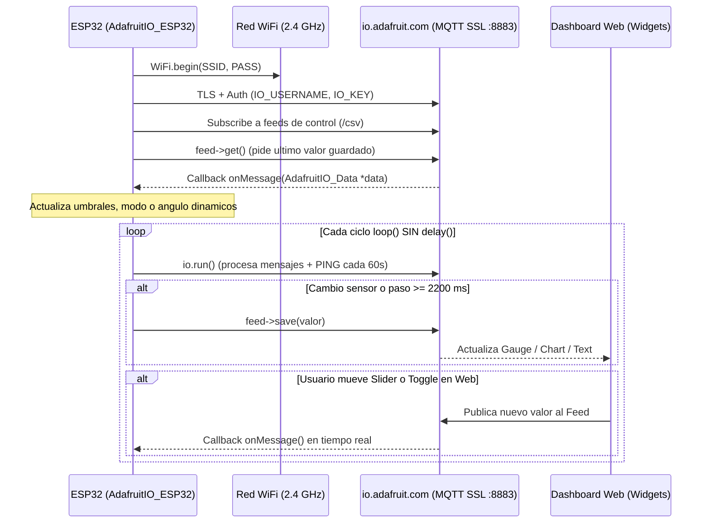

# Lógica de Funcionamiento de Adafruit IO (ESP32 + Dashboard Bidireccional)

Esta guía explica **exactamente cómo funciona Adafruit IO por debajo** (verificado contra la librería instalada `Adafruit_IO_Arduino v4.3.7` y `Adafruit_MQTT_Library v2.6.6`) y cómo armar un **Dashboard bidireccional** que funcione con todos los códigos del repositorio.

---

## 1. Arquitectura General: ¿Cómo Viaja la Información?



### Conceptos Clave de Adafruit IO
1. **Feed (Flujo de datos):** Es la "variable en la nube" (ej. `corto3-temp`). Guarda un historial de valores con fecha y hora.
   - Internamente por MQTT, cuando usas `AdafruitIO_Feed`, la librería construye el tópico `<IO_USERNAME>/f/<nombre-feed>/csv`.
   - **Regla de nombres:** Usa solo minúsculas, números y guiones (`corto3-temp`, `corto3-servo-cmd`). Evita espacios o mayúsculas porque Adafruit IO los convierte a *slugs* (`key`) y luego el código no coincide si no usas el `key` exacto.
2. **Dashboard (Tablero):** Es la interfaz visual con **Blocks (Widgets)** conectados a uno o más Feeds.
   - Un **mismo Feed** puede alimentar un `Line Chart` y un `Gauge` a la vez.
   - Si un Widget es de entrada (**Slider**, **Toggle**, **Text**, **Momentary Button**), al moverlo en la web publica un dato al Feed, y el ESP32 lo recibe al instante dentro de `io.run()` mediante `onMessage(...)`.
3. **Protocolos internos en `Adafruit_IO_Arduino`:**
   - **MQTT sobre TLS (`io.adafruit.com:8883`)**: Lo usan `io.connect()`, `io.run()`, `feed->save()` y `feed->onMessage()`. En ESP32 usa `WiFiClientSecure` con el certificado raíz DigiCert embebido en `AdafruitIO_ESP32.h`.
   - **HTTP REST (`https://io.adafruit.com:443`)**: Lo usan `feed->exists()`, `feed->create()` y `feed->lastValue()`.

---

## 2. Ciclo de Vida Real del Código (`Adafruit_IO_Arduino`)

### A. Instanciación
```cpp
#include "AdafruitIO_WiFi.h"
AdafruitIO_WiFi io(IO_USERNAME, IO_KEY, WIFI_SSID, WIFI_PASS);
AdafruitIO_Feed *feedTemp = io.feed("corto3-temp");
```
- `AdafruitIO_WiFi` es un alias (`typedef`) que en ESP32 selecciona automáticamente `AdafruitIO_ESP32`.
- `io.feed("nombre")` reserva el objeto feed y automáticamente lo **suscribe** al broker MQTT apenas te conectes.

### B. Conexión y Sincronización Inicial (`setup()`)
```cpp
feedUmbral->onMessage(alRecibirUmbral); // 1. Registrar callback ANTES de conectar
io.connect();                           // 2. Inicia WiFi + configura TLS Root CA

while (io.status() < AIO_CONNECTED) {   // 3. Esperar conexión (o usar timeout no fatal)
  Serial.print(".");
  delay(500); // Solo permitido en setup(), NUNCA en loop()
}

feedUmbral->get(); // 4. Pedir a Adafruit el último valor que tenía el Slider!
```
- **¿Por qué `feed->get()` es oro puro en el laboratorio?** Si el ESP32 se reinicia o cambias un código, sin `get()` el ESP32 arrancaría con sus variables por defecto hasta que alguien vuelva a mover el Slider en la web. Con `feed->get()`, Adafruit IO le reenvía el último valor guardado al tópico `/csv/get` y tu callback `onMessage` se actualiza solo.

### C. Bucle Principal (`loop()`) y Estados (`aio_status_t`)
- **`io.run()`** debe ejecutarse en **cada vuelta del `loop()`**:
  1. Revisa si cayó el WiFi o MQTT y reconecta si hace falta.
  2. Lee paquetes entrantes durante `_packetread_timeout` (100 ms por defecto) y dispara tus funciones `onMessage`.
  3. Envía un `PING` cada `60,000 ms` (`AIO_PING_INTERVAL`) para que el servidor no cierre la sesión.
- **Modo seguro si cae internet (`io.run(0, true)` o chequeo `io.status() == AIO_CONNECTED`):**
  - Por defecto `io.run()` sin argumentos intenta reconectar y puede bloquear varios segundos si se cae el router. Si tu sistema tiene **servo o RFID en tiempo real**, puedes verificar `WiFi.status() == WL_CONNECTED` o usar `io.run(10, true)` (modo `fail_fast = true`) mientras manejas reconexión controlada con `millis()`, o dejar `io.run()` cuando WiFi esté arriba para que los sensores locales nunca queden congelados!

### D. Lectura de Valores Dinámicos (`AdafruitIO_Data *data`)
Cuando llega un mensaje a `void miCallback(AdafruitIO_Data *data)`:
- `data->toInt()` -> Convierte el payload a entero (ideal para **Slider** de ángulo `0..180`).
- `data->toFloat()` / `data->toDouble()` -> Convierte a decimal (ideal para **Slider/Text** de umbral `28.5`).
- `data->isTrue()` / `data->isFalse()` / `data->toBool()` -> Evalúa `"1"`, `"true"`, `"ON"`, `"HIGH"` (ideal para **Toggle** o **Botón**).
- `data->toString()` / `data->toChar()` -> Devuelve el texto completo (ideal para **Text Input**, por ejemplo `"ADD:A1:B2:C3:D4"` o `"MODO:AUTO"`).
- `data->toPinLevel()` -> Devuelve `HIGH` o `LOW` directo para `digitalWrite`.

---

## 3. Reglas Anti-Throttle (Lo Que Tira a la Mayoría en el Corto)

En el plan gratuito (**Adafruit IO Free**):
1. **Límite de velocidad:** **30 puntos de datos por minuto** (en promedio **1 dato cada 2 segundos**, sumando **TODOS** tus feeds juntos!).
2. **Límite de feeds:** **10 feeds activos** máximo en tu cuenta.
3. **Almacenamiento por payload:** `AIO_DATA_LENGTH` en la librería es `45` caracteres por defecto en `_value` (así que envía textos cortos y concretos, ej. `"UID:A1B2C3D4|OK"`).

### ¿Qué pasa si envías demasiado rápido?
Adafruit IO te manda un mensaje al tópico oculto `/throttle`, rechaza publicaciones y, si el broker te desconecta con código `6` (*throttled*), la librería `AdafruitIO::status()` dentro de `AdafruitIO_Arduino v4.3.7` puede llamar `mqttStatus()` con `fail_fast=false` y bloquear **`60,000 ms` (`AIO_THROTTLE_RECONNECT_INTERVAL`)**. Por eso la mejor defensa es **nunca** cruzar los 30 datos/min en el código cliente.

### Estrategia ICPC para Nunca Sufrir Throttle (Implementada en nuestros códigos)
1. **Temporizador global mínimo (`INTERVALO_GLOBAL_MS = 2200`):** Nunca permitas dos `save()` seguidos separados por menos de `2.2` segundos (excepto un evento único crítico como lectura RFID con cooldown propio, e incluso ahí respeta el slot mínimo).
2. **Envío por cambio significativo (*Deadband*) + *Heartbeat*:**
   - Si la temperatura era `25.1 °C` y sigue en `25.1 °C`, **no desperdicies cuota** enviándola cada 2 segundos; envíala solo si cambió `>= 0.3 °C` (y un latido cada `15–20 s` si nada cambió).
3. **Round-Robin cuando hay varios sensores:** En `05_sistema_integrado_icpc.ino`, una pequeña cola de prioridad/turnos publica **un feed por turno cada `2500 ms`**, logrando que 4 sensores convivan felizmente sin jamás tocar el límite de 30/min (`60s / 2.5s = 24 msg/min < 30`).

---

## 4. Configuración Única del Dashboard en `io.adafruit.com` (Sirve para TODOS los Códigos)

Crea estos **8 Feeds** (entran dentro del límite gratuito de 10!) en **IO -> Feeds -> + New Feed**:

| # | Nombre del Feed (Key exacto) | Dirección | Widget Recomendado en Dashboard | Rango / Valores |
| :-: | :--- | :--- | :--- | :--- |
| 1 | `corto3-temp` | ESP32 -> Web | **Gauge** y/o **Line Chart** | Min: `0`, Max: `60` (°C) |
| 2 | `corto3-ir` | ESP32 -> Web | **Text / Stream** o **Gauge** | Conteo / Estado (`1`/`0` o texto) |
| 3 | `corto3-servo` | ESP32 -> Web | **Gauge** | Min: `0`, Max: `180` (°) |
| 4 | `corto3-rfid` | ESP32 -> Web | **Text / Stream** | Último UID y estado (`OK`/`DENIED`) |
| 5 | `corto3-umbral` | Web -> ESP32 | **Slider** | Min: `15`, Max: `50`, Step: `0.5` |
| 6 | `corto3-servo-cmd` | Web -> ESP32 | **Slider** | Min: `0`, Max: `180`, Step: `1` |
| 7 | `corto3-modo` | Web -> ESP32 | **Toggle** o **Text Input** | `AUTO` / `MANUAL` (o `1`/`0`) |
| 8 | `corto3-rfid-cmd` | Web -> ESP32 | **Text Input** *(o Momentary Button)* | `LEARN`, `ADD:UID`, `DEL:UID`, `RESET_IR` |

> **Tip rápido de examen:** Si en el corto te piden "un botón para resetear conteo IR" o "una caja para cambiar parámetro", simplemente añade un bloque **Momentary Button** apuntando al feed `corto3-rfid-cmd` con el texto de *Press Value* = `RESET_IR` (o `LEARN`), y ya funciona sin tocar una línea del backend!

### ¿Cómo obtener tu `IO_USERNAME` y `IO_KEY`?
1. Entra a [io.adafruit.com](https://io.adafruit.com) e inicia sesión.
2. En la esquina superior derecha, haz clic en el ícono de la **llave amarilla (`My Key`)**.
3. Copia **`Username`** -> pégalo en `IO_USERNAME`.
4. Copia **`Active Key`** -> pégalo en `IO_KEY`.
5. **Seguridad:** Solo usa redes WiFi **2.4 GHz** (el ESP32 clásico **NO detecta WiFi 5 GHz**!). Si el WiFi de la universidad tiene portal cautivo o bloquea el puerto MQTT `8883`, comparte internet desde tu **Hotspot del teléfono en banda 2.4 GHz**.
